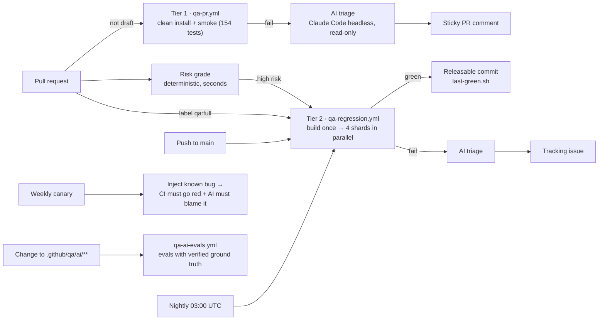

# Etendo QA pipeline

A tiered test pipeline for Etendo with an AI agent that triages failures. The AI layer is itself
measured with evals that have verified ground truth.



## Tiers

| Tier | Workflow | Trigger | What it runs | Gate |
|---|---|---|---|---|
| Risk | `qa-pr.yml` · `risk` | every PR event, drafts included | `risk.py`: fixed rules over the diff → `risk:low/medium/high` label | high forces Tier 2 |
| 1 · PR | `qa-pr.yml` · `smoke` | PR ready for review (not drafts) | `expandCore` → `install` on Postgres 16 → `suites/smoke.txt` (DAL + security, DB-only) | blocks the PR |
| 2 · Regression | `qa-regression.yml` | every push to main, nightly, manual, PR label `qa:full` or high risk | Etendo's `StandaloneTestSuite` (344 classes, ~4.8k tests) split into ordered, time-balanced shards | issue + red run; green runs mark releasable commits |
| Canary | `qa-canary.yml` | weekly, manual | injects a known bug; CI must go red and the AI must blame the change | issue if the pipeline went blind |
| AI evals | `qa-ai-evals.yml` | PRs touching `.github/qa/ai/**` | triage agent against cases with known answers, k trials | pass rate ≥ 80% |
| 3 · Integration | *(roadmap)* | — | `WebserviceTestSuite` (39 classes, needs Tomcat) | — |

## Principles (and where they come from)

| Principle | Implementation | Source |
|---|---|---|
| Separate "this change works" (per PR) from "main works" (after merge) | smoke on PRs; full regression on every push to main; releases only from green commits (`last-green.sh`) | Kun Chen, *4 types of validation* |
| Deterministic gates first; the model only where judgment is needed | gate = `report.py --gate`; risk = `risk.py`; AI only diagnoses | Mark Ajzenstadt; Jalal Ashrafi, *Stop babysitting your PRs* |
| A suite must not get faster by losing tests | `floors.json` minimum counts enforced by `--floor` | Matt Gapp, *CI becomes exponentially slower…* |
| Break something on purpose and confirm CI goes red | weekly canary (`qa-canary.yml`, `canary-check.py`) | Matt Gapp |
| Don't run full CI on drafts | smoke skipped while draft; runs on `ready_for_review` | Matt Gapp |
| A flaky test is a bug with an owner, not something to retry away | retry once only to *classify*; every flaky opens/updates an issue (`flaky-issues.sh`) | Matt Gapp |
| Risk graded on every PR; trust earned in steps | `risk:*` label; AI is at L0–L1 (comments only, never edits or approves) | Jalal Ashrafi |
| Findings must come with evidence | triage schema requires `path:line` evidence; `unknown` over guessing | Josiah Parappally (Ramp/Arcanist) |
| Split jobs by recorded time; each shard pays setup once | build once + DB snapshot; LPT-style balancing on `timings.json` | Matt Gapp |

## How the pieces work

- **Build once, test many.** The regression build job runs `install` once, then publishes a
  `pg_dump` (~26 MB) and the compiled workspace (~94 MB zstd). Each shard restores both and starts
  testing, without spending ~5 minutes on its own install. The dump and the restore run inside the
  Postgres service container, so the client and server versions always match.
- **Ordered, time-balanced shards** (`plan-shards.py`). Some Etendo tests depend on execution
  order (costing, org trees), and Gradle ignores the order of `--tests`. So each shard is a
  *contiguous slice* of the official suite, emitted as a generated `@Suite @SelectClasses` class that
  keeps that order. Nested suites stay whole. Slice boundaries are chosen by binary search on the
  bottleneck time, using per-class timings measured on a clean install (`timings.json`). With 4
  shards the longest is ~171s, against ~617s of sequential test time. The floor is `TaxesTest`
  (a single class), so asking for more shards gains nothing and the planner returns fewer.
- **Suites come from Etendo itself** (`build-suites.py`). It parses the official
  `StandaloneTestSuite` (DB-only) and `WebserviceTestSuite` (needs Tomcat), including
  `@SelectClasses`, `@SelectPackages` and `@ExcludeClassNamePatterns`, so new core tests join
  automatically after a core upgrade. Checked: the planned set equals the 344 classes the official
  suite actually executes.
- **Quarantine** (`known-failures.txt`). Tests that fail on a clean install, each listed with its
  verified cause and with method-level patterns allowed. They still run. `report.py --gate` fails only
  on *new* failures, and flags quarantined tests that start passing. The gate sits in the report, not
  in Gradle filters, because Gradle exclusions do not reach classes inside JUnit suites. That was
  checked: they ran anyway.
- **Flaky detection** (`qa.init.gradle`). The Gradle test-retry plugin is injected through an init
  script, so `build.gradle` is untouched. A test that fails and then passes on retry is reported as
  flaky, not as a failure.
- **Deterministic locale.** The JVM and Postgres are pinned to English. Locally, a Spanish locale
  made 3 core tests fail.

## AI triage (`ai/`)

- `triage.sh` runs `claude -p` headless with **read-only tools** (`Read, Grep, Glob`) and
  `--permission-mode dontAsk`. It returns **schema-validated JSON** (`--json-schema`): one verdict
  per test (`regression | test_defect | needs_server | environment | flaky | unknown`), with
  evidence as `path:line` and a flag for whether the PR's diff caused the failure.
- It is the same script in CI and locally, and the same rules as the `qa-triager` agent in `.claude/`.
- It costs about **$0.30 per triage**, takes about 45s, and runs only when tests fail.

### Evals (`ai/evals/`)

Following Anthropic's *Demystifying evals for AI agents*: tasks with verified ground truth, a
deterministic grader that checks the outcome rather than the path, k trials, and pass@k / pass^k.

| Case | Ground truth (verified) |
|---|---|
| `needs-server-datasource` | test calls Tomcat over HTTP |
| `test-defect-hql-entity` | test iterates an HQL-origin entity that has no Java class (capability eval: still failing) |
| `env-postgres-locale` | Postgres `lc_messages=es_AR` |
| `env-jvm-locale` | JVM default locale `es_AR` |
| `regression-password-offbyone` | real mutation (`>=` → `>`) applied as the PR diff |

Current result (k=3, `sonnet`): **12/15 trials (80%)**. The 4 solved cases pass 3/3 (pass^k).
The HQL case fails 3/3: the agent answers `unknown`/`environment` instead of guessing the cause.
It stays as an open capability target, and the answer is not hard-coded into the prompt.

`run-evals.py --regrade` re-scores stored transcripts without calling the model. Use it when
changing the grader. That is how a grader bug was found: the grader demanded fully-qualified
test names, which made the first run score 0/5.

## Local use

```bash
# Same entrypoint as CI (JDK 17, DB from gradle.properties)
JAVA_TOOL_OPTIONS="-Duser.language=en -Duser.country=US" .github/qa/run-tests.sh .github/qa/suites/smoke.txt
python3 .github/qa/report.py --out build/qa build/test-results/test
.github/qa/ai/triage.sh build/qa/failures.json - build/qa      # needs a logged-in `claude`
```

In Claude Code, `/qa [smoke|regression|<pattern>]` does all of the above and delegates failures to
the `qa-triager` subagent.

## Required secrets

| Secret | Use |
|---|---|
| `ETENDO_GITHUB_USER`, `ETENDO_GITHUB_TOKEN` | PAT with `read:packages` for Etendo's GitHub packages |
| `ETENDO_NEXUS_USER`, `ETENDO_NEXUS_PASSWORD` | optional; not yet confirmed whether they are required |
| `ANTHROPIC_API_KEY` | AI triage, evals and canary, billed to the API account |
| `CLAUDE_CODE_OAUTH_TOKEN` | Alternative to the API key: a subscription token (Pro/Max/Team/Enterprise) from `claude setup-token`, valid one year. If both are set, the API key wins. Never run the scripts with `--bare`, which ignores this token. Without either secret, the AI steps are skipped |
